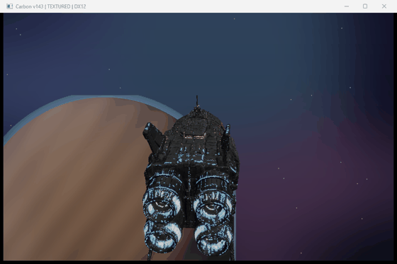
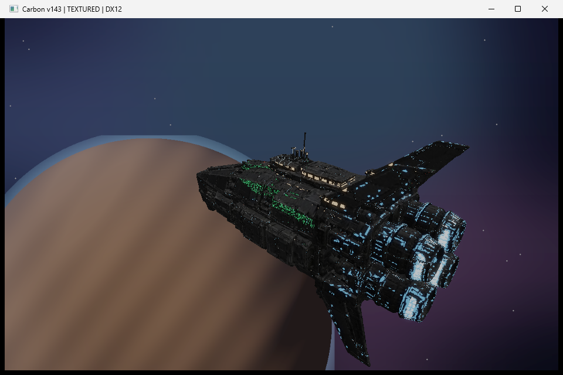
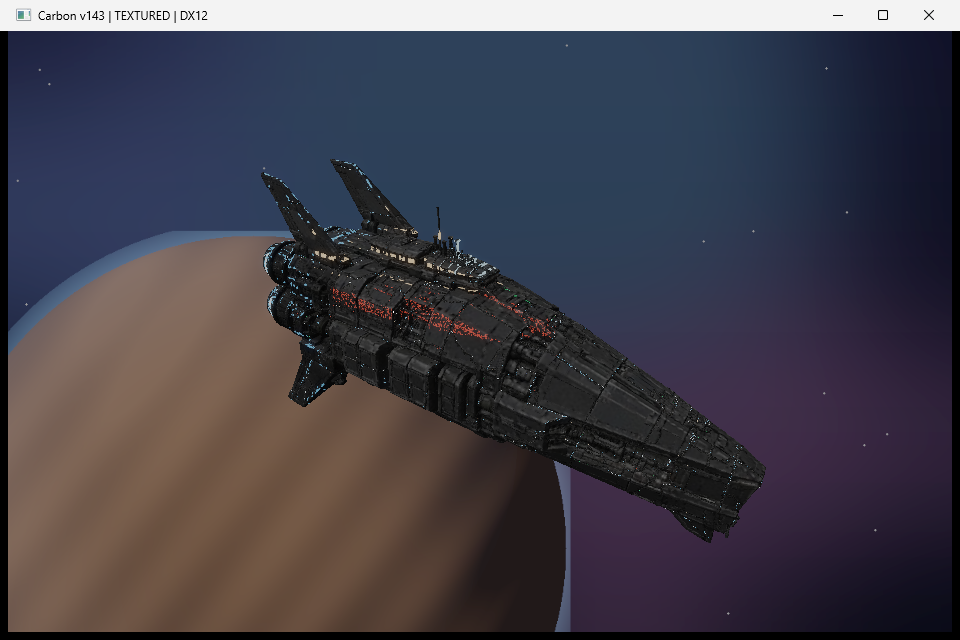

# Carbon Ship

A textured, lit spaceship rendered in **[Carbon](https://github.com/carbonengine)** — the open-source engine behind EVE Frontier — built from source and driven from Python.

*Recorded live from the running engine — title bar and all. A higher-quality clip is in [`carbon_ship.mp4`](carbon_ship.mp4).*

## What this is

A community render, not a mock-up. Everything here runs in Carbon's own Trinity DX12 renderer, through Blue, on a from-scratch build of the open-source components.

- **Engine from source.** Carbon's public components (core, math, scheduler, io, resources, blue, trinity) compiled on MSVC v143, with a small C++ host that runs Blue's boot sequence and brings up a DX12 device and window.
- **The ship.** An original industrial-scout hull, generated with Tripo, decimated, and drawn as geometry through `Tr2SolidSet` with custom "Solids" shaders compiled from Trinity's own shader sources.
- **Lighting.** A worn-salvager theme with lights placed by 3D position and baked into an emissive map — warm crew windows, a cool cockpit, blue-white engine cores, and red/green navigation markers — rather than a flat tint.
- **Post.** An HDR scene target plus a custom fullscreen bloom chain (bright-pass, separable blur, tonemapped composite) for the glow.
- Runs at roughly 60 FPS on an RTX 3070 laptop GPU.

## Why

Carbon was open-sourced so people could build on it. This is a small proof that a community developer can stand the engine up and put real, lit content on screen — the same renderer and pipeline behind our EVE Frontier Bounty Board work.

Built by **Honey Badger**.
